  

  <a href="https://portfolio-two-tau-nxuu36kuf5.vercel.app/"><b>portfolio</b></a> ·
  <a href="https://www.linkedin.com/in/rupanjanac/"><b>linkedin</b></a> ·
  <a href="mailto:rupp1510@gmail.com"><b>email</b></a> ·
  <a href="https://portfolio-two-tau-nxuu36kuf5.vercel.app/play/doodle-derby/index.html"><b>play doodle derby</b></a>

hi, i'm rupanjana. i work mostly in java, and outside work i build whatever i'm curious about at the moment. lately that's small language models, AI agents and a racing game.

### 🐾 right now

- training a small model to flag risky clauses in terms of service
- rebuilding my job tracker by hand, one layer at a time, from the database to the deploy

### ✨ things i've made

- 🔍 **[Fine Print](https://github.com/rupanjana15/fine-print)**: a 3B model fine-tuned to read terms of service and flag the clauses worth worrying about, with how serious each one is and the exact line it's quoting. when it flags something, it's right 93% of the time.  Python · Qwen2.5 · QLoRA · llama.cpp
- 🤖 **my agents**: two Claude agents i use every day. one finds jobs, scores them against what i'm looking for and drafts a tailored résumé, and i review and send everything myself. the other plans my day and reminds me when a task is due.  Claude · scheduled agents · private
- 🏎️ **[Doodle Derby](https://github.com/rupanjana15/doodle-derby)**: draw a car, turn it into a 3D model and race it against AI cars on a sketchbook track. **[play it in your browser →](https://portfolio-two-tau-nxuu36kuf5.vercel.app/play/doodle-derby/index.html)**  Three.js · cel shading · arcade physics
- 🧠 **[ExplainGPT](https://github.com/rupanjana15/ExplainGPT)**: shows what GPT is doing as it picks each word, with token probabilities and attention visualised.  FastAPI · PyTorch · Transformers · Next.js
- 🗺️ **[Developer Journey](https://github.com/rupanjana15/developer-journey)**: the tracker i use to plan what to learn and keep a record of what i've done.  Next.js · React · Drizzle · Cloudflare
- 😏 **BeForReal**: sarcasm detection with a fine-tuned BERT model, as an [API](https://github.com/rupanjana15/beforreal-backend), a [website](https://github.com/rupanjana15/beforreal-website) and a [chrome extension](https://github.com/rupanjana15/beforreal-extension).  FastAPI · BERT · Next.js · Manifest V3

### 🛠️ recently worked on

<!-- recent:start -->
- **[fine-print](https://github.com/rupanjana15/fine-print)**: Fine-tuned 3B LLM that flags risky clauses in Terms of Service Python · updated 16 Nov 2026
- **[portfolio](https://github.com/rupanjana15/portfolio)**: a little visual resume because reading a document can be boring <3 JavaScript · updated 12 Nov 2026
- **[job-tracker](https://github.com/rupanjana15/job-tracker)** updated 6 Nov 2026
- **[doodle-derby](https://github.com/rupanjana15/doodle-derby)** JavaScript · updated 30 Oct 2026
- **[money-tracker](https://github.com/rupanjana15/money-tracker)**: to track my money , goals and calories? everything in one which i would like to update and keep myself in check with everyday TypeScript · updated 1 Sept 2026
<!-- recent:end -->

### 🧰 tools i use

  
  
  
  
  
  
  
  
  
  
  
  

🐈 this readme updates itself every morning. <!-- updated:start -->last change: 17 Nov 2026.<!-- updated:end -->

